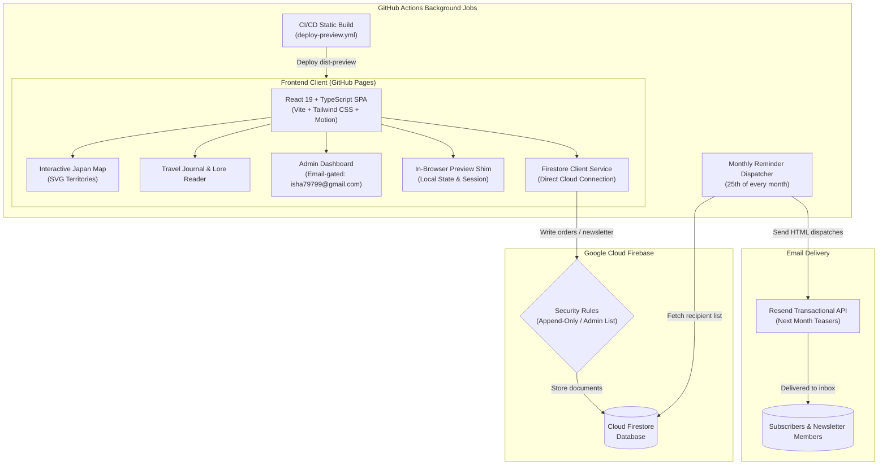

# Kokoro Letters &bull; 心

**A monthly slow-craft journey through Japan's 12 scenic realms.**

*Handmade, hand-printed physical mail club connecting travelers to the real-world landscapes that inspired Studio Ghibli.*

---

## 🍃 About Kokoro Letters

**Kokoro Letters** (心) is an interactive physical subscription club and digital sanctuary. Over the course of twelve months, subscribers travel across **12 scenic regions of Japan**—from the birch frost of Hokkaido and Sayama Hills' camphor forests (*Totoro*) to the sacred waters of Ise-Shima (*Spirited Away*) and the ancient moss-draped cedars of Yakushima (*Princess Mononoke*).

Every month, a handcrafted physical kit arrives at the subscriber's doorstep, accompanied by an interactive digital travel journal and collectible map.

---

## ✨ Core Features & Functionalities

### 1. 🗾 Interactive 12-Region Japan Map
- **SVG Cartography:** A custom-rendered map of Japan featuring all 12 regions with interactive territorial highlights.
- **Dynamic Lock/Unlock System:** 
  - Past & present regions stay strictly **locked** until unlocked via paid subscription.
  - Future territories display **Coming Soon** countdown badges.
  - Interactive unlock stamp animation when a region is activated.
- **Physical-to-Digital Parity:** In Month 1, subscribers receive a large physical map; each subsequent month delivers a physical stamp sticker to stick onto their physical map alongside their digital progress.

### 2. 📦 Physical Monthly Keepsake Kit
Every envelope is manually hand-printed and assembled with pure slow craftsmanship:
- 🎨 **Ghibli Art Print:** Hand-printed scenery of the real-world location that inspired the animation.
- ✨ **Anime Spirit Sticker:** Custom-illustrated collectible character/spirit sticker.
- 🏷️ **Regional Stamp Sticker:** Territory sticker to affix to the collectible Japan map.
- 📜 **Creator's Lore Letter:** Personal narrative detailing local folklore, scenic history, and the story of how the region inspired Japanese cinema.

### 3. 📖 Digital Travel Journal & Sanctuary
- **Lore Reader:** In-depth essays and scenic photographs for every unlocked region.
- **Ambient Sound Simulator:** Built-in audio simulator for meditation and reading (*Gentle Wind*, *Mountain River*, *Ocean Waves*).
- **Personalized Traveler Ledger:** Tracks total progress (e.g., `3 of 12 Regions Covered`), active tier, and fulfillment destination.

### 4. 📜 Cultural Newsletter & Teasers
- **Whispers from the Next Region:** Monthly teasers highlighting the upcoming region's lore and Ghibli themes.
- **Duplicate Prevention:** Automatic deduplication against Cloud Firestore; users attempting to sign up with an existing email receive an immediate notification (`"You are already signed up! 🍃"`).
- **Logged-in Detection:** When a subscriber logs in, the form automatically converts into a sealed confirmation scroll confirming their active subscription.

### 5. 🎟️ Traveler's Ticket & Direct Checkout
- **Tier Selection:** Supports both **Domestic (India Tier)** and **International Tier** pricing and shipping routes.
- **Direct Order Processing:** Collects shipping details, recipient address, and tier preferences directly into Cloud Firestore.

### 6. 🔐 Admin Operations Dashboard (Private)
- **Role-Gated Security:** The Admin Dashboard is **completely invisible** to the public and regular subscribers. It dynamically unlocks only when the authorized admin email (`isha79799@gmail.com`) logs into the site.
- **Real-Time KPI Metrics:**
  - 🌿 **Subscribers (This Month):** Tracks active subscriptions initiated in the current calendar month + all-time total.
  - 📜 **Newsletter Audience:** Total newsletter subscriber count + monthly growth tracker (`+X this month`).
  - 🔄 **Renewed Subscriptions:** Counts recurring subscribers who renewed their dispatch for the current cycle.
  - 🍂 **Dropped / Churned:** Tracks cancelled or paused subscriptions.
- **Live Status Management:** Admins can change any subscriber's status between `Active`, `Renewed`, and `Cancelled` in real time.
- **Fulfillment CSV Export:** Generates and downloads formatted shipping label spreadsheets ready for printing and postage.
- **Newsletter CSV Export:** Exports audience contact lists for email campaigns.

### 7. ⏰ Automated Monthly Reminder Scheduler
- **Background Cron Automation:** A scheduled GitHub Actions workflow runs on the **25th of every month** (`cron: '0 9 25 * *'`).
- **Upcoming Region Preview:** Pulls all subscriber and newsletter emails from Firestore, determines the next month's territory, and dispatches a Ghibli-themed reminder invitation via transactional email (Resend API) so subscribers never miss the upcoming batch cut-off.

---

## 🏛️ System Architecture

---

## 🗄️ Database Collections Schema (Cloud Firestore)

| Collection | Document ID | Fields | Purpose |
|---|---|---|---|
| **`newsletter`** | `clean_email` | `name`, `email`, `createdAt`, `createdDate` | Stores cultural newsletter signups and monthly teaser subscribers. Primary key is the email to enforce uniqueness. |
| **`orders`** | Auto-generated UID | `email`, `shipping_address`, `plan_tier`, `gateway`, `status`, `createdAt`, `createdDate` | Stores active subscription orders, shipping fulfillment addresses, and renewal statuses (`Active`, `Renewed`, `Cancelled`). |
| **`waitlist`** | `clean_email` | `email`, `source`, `createdAt`, `createdDate` | Early access and interest waitlist records. |

---

## 🛡️ Security Architecture

1. **Client-Side Data Protection:**
   The frontend code is hosted publicly on GitHub Pages, but customer data **never lives in the repository**. All customer information is transmitted directly from the client browser to Google Cloud Firestore over TLS.

2. **Firestore Append-Only Security Rules:**
   - **Public Visitors:** Allowed to `create` new newsletter and order records and `get` their own record (for existence checks). 
   - **Scrape Protection:** The `list` operation is strictly disallowed for unauthenticated users, preventing malicious actors from enumerating or downloading the subscriber directory.
   - **Tamper Protection:** Public users cannot `update` or `delete` existing records.

3. **Admin Privilege Verification:**
   - The Admin Ledger navigation and view components are restricted to authorized email addresses (`ADMIN_EMAILS = ["isha79799@gmail.com"]`).
   - Unauthorized attempts to navigate to `?tab=admin` trigger an automatic redirect back to the home journey.

---

## 🗾 The 12-Month Regional Itinerary

| Month | Region | Cinematic Theme / Inspiration | Featured Scenery |
|:---:|---|---|---|
| **1** | **Hokkaido** | *Golden Kamuy* & northern frontiers | Frozen birch woods, Furano lavender, outdoor thermal onsens |
| **2** | **Tohoku** | *Princess Mononoke* ancient roots | 1,000-year-old cedars of Dewa Sanzan, Hirosaki Castle sakura |
| **3** | **Shinshu (Nagano)** | *The Wind Rises* & alpine tranquility | Snow-capped Japanese Alps, Jigokudani steaming pools, Zenko-ji |
| **4** | **Kanto (Sayama Hills)** | *My Neighbor Totoro* | Camphor groves, rolling tea hills, Meiji Jingu cedar paths |
| **5** | **Chubu (Fuji)** | *Hyouka* & traditional timber craft | Mount Fuji sunrise lakes, steep-roofed houses of Shirakawa-go |
| **6** | **Ise-Shima** | *Spirited Away* sacred ocean portals | Sacred Shinto shrines, emerald coves, traditional pearl diving bays |
| **7** | **Kansai (Kyoto & Tomo)** | *Ponyo on the Cliff by the Sea* | Arashiyama bamboo groves, raked zen gardens, port town of Tomonoura |
| **8** | **Chugoku (Miyajima)** | *Whisper of the Heart* inspiration | Floating red Torii gate of Itsukushima, dynamic Tottori sand dunes |
| **9** | **Seto Inland Sea** | *Kiki's Delivery Service* coastal breeze | Island ferries, hillside lemon orchards, calm tranquil straits |
| **10** | **Shikoku** | *Pom Poko* pilgrimage forest trails | 88 sacred temple paths, vine suspension bridges of Iya Valley |
| **11** | **Kyushu (Yakushima)** | *Princess Mononoke* forest of the gods | Moss-covered ancient Yakusugi cedars, Mount Aso caldera |
| **12** | **Okinawa** | *Ocean Waves* & southern sanctuaries | Turquoise coral lagoons, Ryukyu stone walls, melodic sanshin music |

---

## 🛠️ Technology Stack

- **Framework:** [React 19](https://react.dev/) + [TypeScript](https://www.typescriptlang.org/)
- **Build Tool:** [Vite 6](https://vitejs.dev/) with `@tailwindcss/vite`
- **Styling:** [Tailwind CSS v4](https://tailwindcss.com/) with custom Ghibli vintage palette (`ghibli-green`, `ghibli-sand`, `ghibli-cream`, `vintage-shadow`)
- **Animation:** [Motion (framer-motion)](https://motion.dev/) for page transitions, tab switches, and unlock stamp celebrations
- **Icons:** [Lucide React](https://lucide.dev/)
- **Database:** [Google Cloud Firestore](https://firebase.google.com/docs/firestore)
- **Deployment:** [GitHub Pages](https://pages.github.com/) (100% static client-side SPA with `404.html` routing)
- **Email Automation:** [GitHub Actions Cron](https://docs.github.com/en/actions/using-workflows/events-that-trigger-workflows#schedule) + [Resend API](https://resend.com/)

---

*“Step through the meadow into the spirit world.”* &bull; **Kokoro Letters**

